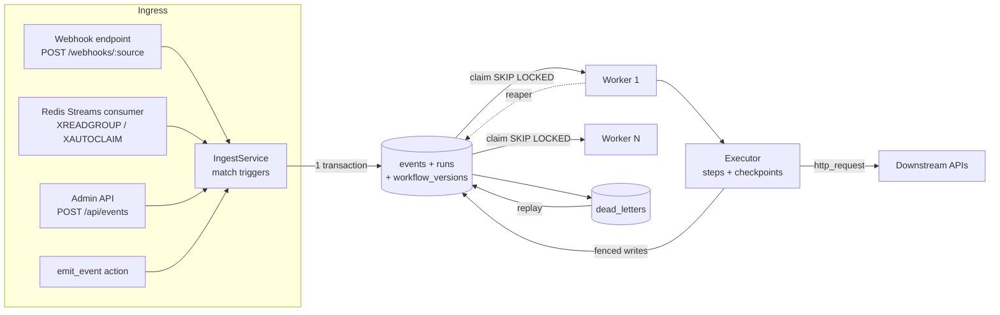
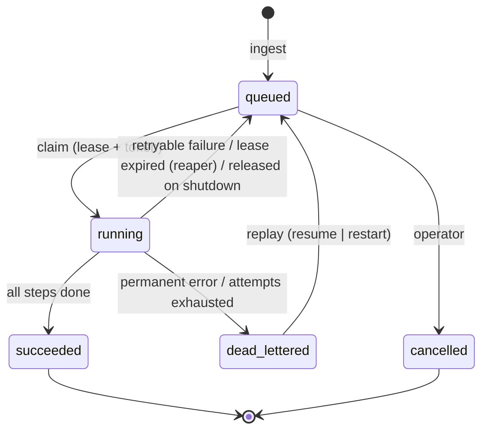

# Architecture

## Components



| Module | Responsibility |
| --- | --- |
| `eta/ingress/webhook.py` | HTTP contract, body limits, signature verification, event type and idempotency key extraction, header scrubbing |
| `eta/ingress/redis_streams.py` | Consumer groups, ack-after-commit, stale-message reclaim, poison handling |
| `eta/ingress/service.py` | The single ingest path: trigger matching plus an atomic write of the event and its runs |
| `eta/workflows/*` | YAML DSL (pydantic), matcher, sandboxed templating, content-hashed versions |
| `eta/db/store.py` | All persistence and state transitions; claim, lease, fence, checkpoint, DLQ |
| `eta/engine/executor.py` | Runs one leased run step by step and decides between retry, continue and DLQ |
| `eta/engine/worker.py` | Concurrency, polling and wake-ups, heartbeats, reaper, graceful drain |
| `eta/actions/*` | Action plug-in interface and built-ins |
| `eta/api/app.py` | FastAPI app: webhooks, admin API, probes, metrics |

All components are stateless processes. The database is the only shared state, so
you can run any number of API, worker and consumer replicas.

## Data model

```
events(id, source, event_type, idempotency_key, payload, headers, ingress, received_at)
  UNIQUE(source, idempotency_key)                         -- ingress dedupe

workflow_versions(name, version, spec)                    -- immutable snapshots
  PK(name, version)                                       -- version = sha256(spec)[:16]

runs(id, event_id, workflow_name, workflow_version, status, attempts, generation,
     next_attempt_at, lease_owner, lease_token, lease_expires_at, current_step,
     last_error, created_at, updated_at, finished_at)
  UNIQUE(event_id, workflow_name)                         -- one run per trigger
  INDEX(status, next_attempt_at)                          -- claim
  INDEX(status, lease_expires_at)                         -- reaper

step_results(run_id, step_id, status, attempts, output, error, started_at, finished_at)
  PK(run_id, step_id)                                     -- checkpoints

run_history(id, run_id, ts, kind, detail)                 -- audit timeline
dead_letters(id, kind[run|ingress], status[open|replayed|discarded], run_id,
             workflow_name, source, reason, error, payload, replay_count, ...)
```

## Run state machine



Step states are `running`, `succeeded`, `failed`, `skipped` (`when` was false) and
`failed_continued` (failed, but the step has `continue_on_error`). `succeeded`,
`skipped` and `failed_continued` are **checkpoints**: a retried or resumed run never
executes them again.

## Claiming and leasing

```sql
-- Postgres
WITH candidates AS MATERIALIZED (
  SELECT id FROM runs
  WHERE status = 'queued' AND next_attempt_at <= :now
  ORDER BY next_attempt_at LIMIT :n
  FOR UPDATE SKIP LOCKED)
UPDATE runs SET status='running', lease_owner=:w, lease_token=:tok,
                lease_expires_at=:now + :lease, attempts = attempts + 1
FROM candidates WHERE runs.id = candidates.id AND runs.status = 'queued'
RETURNING runs.*;
```

* `MATERIALIZED` matters. The tests showed that an `IN (subquery … LIMIT n)` form can
  be re-evaluated by the planner and claim more than `n` rows.
* SQLite uses the same statement without row locks. Every transaction is
  `BEGIN IMMEDIATE`, so claims serialize on the database write lock.
* A heartbeat extends the lease every `heartbeat_interval` (which must be shorter
  than `lease_seconds`). If the heartbeat finds the token changed, the worker
  cancels its in-flight execution right away.
* Every transition (`start_step`, `finish_step`, `schedule_retry`,
  `dead_letter_run`, `complete_run`, `release_run`) runs
  `UPDATE runs … WHERE id=:id AND lease_token=:tok AND status='running'` first. If no
  row matches, the transition raises `LeaseLostError` and the transaction rolls back.
* The **reaper** runs on every worker and looks for `running` runs whose
  `lease_expires_at < now`. It requeues them with backoff, or dead-letters them if the
  in-flight step has no attempts left. Its own writes are fenced with
  `require_expired`, so it can't steal a lease that a late heartbeat just renewed,
  and two reapers can't both win.

## Idempotency, end to end

| Layer | Mechanism | Protects against |
| --- | --- | --- |
| Ingress | `UNIQUE(source, idempotency_key)` + `INSERT … ON CONFLICT DO NOTHING` | Provider redelivery, sender retries after timeouts, Redis redelivery |
| Run creation | `UNIQUE(event_id, workflow_name)`, written in the same transaction | Double fan-out |
| Execution | Step checkpoints: completed steps are skipped on retry or resume | Re-running side effects after a later step fails |
| Downstream | `Idempotency-Key: {run_id}:{generation}:{step_id}` is identical across retries and changes only on an explicit *restart* replay | A crash *after* the downstream call but *before* the checkpoint |

Delivery is **at-least-once per step**. It becomes **effectively-once** when the
downstream honours the idempotency key, which the engine always supplies. `emit_event`
uses the same key as the child event's idempotency key, so a chained workflow can't
fan out twice.

Where does the idempotency key come from at ingress?

* For a webhook source, from the configured header or JSON path (for example
  `X-GitHub-Delivery` or Stripe's `id`). If neither is configured, it's the SHA-256 of
  the raw body.
* For a Redis Streams source, from the configured field. If that's missing, it's
  `stream:message-id`, which stays stable across redeliveries.

## Retry policy

```
backoff(n) = min(initial_delay * multiplier^(n-1), max_delay)
delay      = uniform(0, backoff(n))              # full jitter (default)
delay      = max(delay, Retry-After)             # capped at 24h
```

`max_attempts` counts the first execution. Attempts are counted per step and charged
*before* the step runs, so a worker crash still consumes one. Each step uses its
own `retry` override if set, otherwise the workflow's policy.

| Error | Classification |
| --- | --- |
| `RetryableError`, timeouts, connection errors, HTTP 408/425/429/5xx, unexpected exceptions | retry |
| `PermanentError`, HTTP 4xx (other), template/undefined-variable errors, invalid action params, non-JSON output | dead-letter immediately |

## Failure modes

| Failure | Behaviour |
| --- | --- |
| Worker killed mid-step | Lease expires, the reaper requeues the run (the attempt counts), and another worker resumes from the last checkpoint |
| Worker paused (GC, network partition) past its lease | The run is reclaimed. Every write from the old worker is fenced off, and its heartbeat detects the loss and cancels the step |
| DB unavailable at ingest | Webhook returns `503` (sender retries). The Redis message stays un-acked and is reclaimed later |
| DB unavailable in worker | Claim loop backs off exponentially. In-flight runs are recovered by the reaper after the lease expires |
| Downstream outage | Backoff with jitter. Once attempts run out, the run goes to the DLQ for bulk replay after recovery |
| Bad deploy (template typo) | Permanent error, so the run goes to the DLQ. Fix the workflow and replay with `use_latest_workflow` |
| Poison queue message | Dead-lettered (`kind=ingress`) and acked, so it can't block the stream |
| SIGTERM | Stop claiming, drain within the grace period, then release the remaining runs without charging attempts |

## Scaling notes

* Add workers for execution throughput. Each process is bounded by client CPU (see
  the README benchmark), and Postgres row locking with `SKIP LOCKED` keeps claims
  contention-free.
* Polling latency is `poll_interval` (default 1s) for runs created by another process.
  Runs created in the same process wake the worker immediately. Postgres
  `LISTEN/NOTIFY` is on the roadmap.
* `run_history` and `events` grow without bound. Partition them or prune by
  `received_at` (see OPERATIONS.md).
